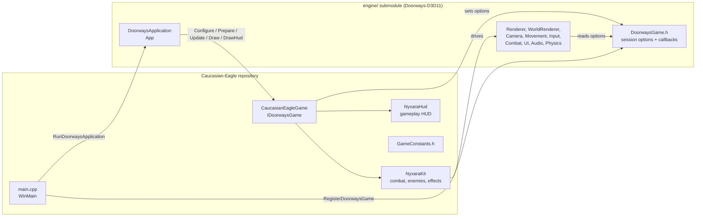

# 4. Architecture

[← Index](TECHNICAL_DOCUMENTATION.md)

## 4.1 Two projects, one executable



- The game is **one executable**, `CaucasianEagle.exe`. It contains the game code and the whole engine, linked statically [confirmed: `game/CaucasianEagle.vcxproj` `ProjectReference` to `DoorwaysEngine.vcxproj`].
- The engine owns the window, the frame loop, rendering, physics, input, menus and audio. The game is called at five points in that loop [confirmed: `engine/src/DOORWAYS/DoorwaysGame.h`].
- The engine source never names the game. Everything the game needs is expressed as a generic option or callback in `DoorwaysGame.h` [confirmed: no match for "Nyxara" in `engine/src`, `engine/Source`, `engine/Tools`].

## 4.2 Who owns what

| Concern | Owner | Notes |
|---|---|---|
| Window, device, swap chain, frame loop | Engine | `App` |
| Scene loading, collision, physics | Engine | Game only names the scene (`StartSceneId`) |
| Player movement, jump, flight | Engine | Game adjusts it through session options (walk speed, boost, impulse, hold-facing) |
| Camera | Engine | Game supplies orbit-rig numbers |
| Player health, damage intake | Engine `CombatSystem` | Game deals damage to the player only through `CombatSystem::ApplyIncomingDamage` |
| Skeletal animation playback | Engine | Game selects clips through the clip override and travel override hooks |
| Hero character assets | Game | `game/assets/Compiled/Characters/Nyxara/EagleV1` |
| Skills, combos, cooldowns, hit timing | Game | `NyxaraKit` |
| Enemies, bosses, chests, arenas, story cards, the ending, the journey save | Game | `Journey`; creatures live in the kit's enemy slots, they are not engine monsters |
| Where the player may walk | Engine physics, with the game's scene collision (`SceneCollision`) | `Journey::Leash` adds the gates and the soft road edge |
| Visual effects | Game | Meshes built in code, textures from `Effects/Nyxara` |
| Gameplay HUD | Game | `NyxaraHud`; replaces the engine's text HUD during play |
| Menus, settings, inventory, progression screens | Engine | Engine defaults in v0.1 |

## 4.3 Frame order

One frame of play, in order [confirmed: `engine/src/DOORWAYS/App.cpp`, `AppGame.cpp`]:

1. Engine reads input and updates UI.
2. `Game::ScaleFrameTime` returns the simulation step. The kit returns 6% of real time during hit-stop.
3. Engine applies respawn, then calls `Game::Update`. The kit reads keys, starts or cancels actions, fires hits, moves enemies and effects, and sets the animation clip override and session options (impulse, hold-facing, camera shake).
4. Engine moves the player (reading those options), samples animation, updates the camera.
5. Engine draws the world, then calls `Game::Draw` for the mountain, creatures, props and effects.
6. Engine draws the HUD: `Game::DrawHud` draws the game HUD and returns true, so the engine's text HUD is skipped.

## 4.4 Runtime layout

The engine finds its content by walking up from the executable until a folder contains both `assets/shaders` and `assets/Compiled/Scenes` [confirmed: `engine/src/DOORWAYS/DoorwaysRuntimePathResolver.cpp`]. The game therefore runs from a self-contained **stage folder**:

```
build/stage/CaucasianEagle/
├── CaucasianEagle.exe
└── assets/
    ├── shaders/  ui/  textures/      from engine/assets
    └── Compiled/                     engine/assets/Compiled, then game/assets/Compiled on top
```

The same folder is what the installer will pack ([09-build-package-release.md](09-build-package-release.md)).
