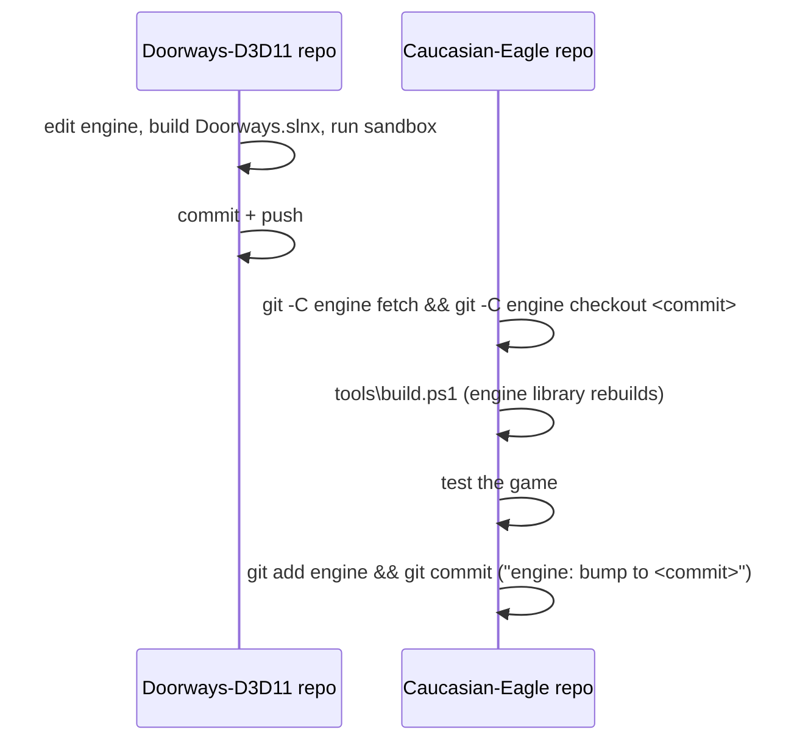

# 6. Core workflows

[← Index](TECHNICAL_DOCUMENTATION.md)

Commands are run from the repository root in PowerShell unless stated otherwise.

## 6.1 Get the project on a new machine

```powershell
git clone --recurse-submodules https://github.com/kalk1t/Caucasian-Eagle.git
cd Caucasian-Eagle
powershell -ExecutionPolicy Bypass -File tools\build.ps1 -Run
```

Needs Visual Studio 2026 with "Desktop development with C++" and the Windows SDK 10.0.26100. `build.ps1` restores the engine's NuGet package, builds, stages and (with `-Run`) starts the game.

## 6.2 Change game code

1. Edit files under `game/src/`.
2. `tools\build.ps1 -Run`.
3. Commit in this repository.

Only the game executable recompiles; the engine library is reused.

## 6.3 Change the engine

The engine is never edited through `engine/` here.



If the game needs something the engine does not offer, add a general option or callback to `engine/src/DOORWAYS/DoorwaysGame.h` in the engine repository. Do not add game names or game-specific branches to engine code ([06-engine-interface.md](06-engine-interface.md)).

## 6.4 Rebuild the hero (Nyxara)

Source files live under `art/nyxara/` on the workstation; the heavy ones are not in git ([art/README.md](../art/README.md)).

```powershell
# 1. Assemble body + wings + swords, author the 31 clips, export the glTF
& "C:\Program Files\Blender Foundation\Blender 5.2\blender.exe" -b -P art\nyxara\blender\assemble.py

# 2. Compile into the engine formats (delete the old bundle first)
Remove-Item -Recurse -Force game\assets\Compiled\Characters\Nyxara\EagleV1
engine\Tools\DoorwaysAssetBuilder\x64\Debug\DoorwaysAssetBuilder.exe character-pipeline `
    art\nyxara\blender\Nyxara_game.glb game\assets\Compiled\Characters\Nyxara\EagleV1 `
    Idle BasicAttack Walk Run StrafeLeft StrafeRight WalkBackward Jump JumpAirborne JumpLanding `
    SlashLeft HeavyAttack Dodge HitReact Death Respawn Skill1 Skill2 Skill3 `
    Combo1L Combo1R Combo2L Combo2R Combo3L Combo3R Guard SwordSwap `
    FlightHover FlightTravel FlightTakeoff FlightLanding

# 3. Stage and run
tools\build.ps1 -Run
```

The pipeline must print `[PASS] Native character pipeline; signature=DoorwaysRig_v1_74bb2d2053cd36e2`. A different signature means the skeleton changed and the clip list or the kit may need updating. The asset builder is an engine tool and is built from the engine repository's solution [confirmed for the engine repository checkout; building it inside the submodule has not been tried].

## 6.5 Rebuild the map (Moonlit Sanctuary alone; version 0.1 only, not part of the game any more)

```powershell
& "C:\Program Files\Blender Foundation\Blender 5.2\blender.exe" -b art\moonlit-sanctuary\Moonlit_Sanctuary_v01.blend `
    -P art\moonlit-sanctuary\Export\export_game_glb.py -- art\moonlit-sanctuary\Export\MoonlitSanctuary_Game_v01.glb

engine\Tools\DoorwaysAssetBuilder\x64\Debug\DoorwaysAssetBuilder.exe scene-pipeline `
    art\moonlit-sanctuary\Export\MoonlitSanctuary_Game_v01.glb game\assets\Compiled MoonlitSanctuary
```

This writes the scene, static mesh, materials and collision files under `game/assets/Compiled/` [inferred from the engine-repository workflow; this exact command has not been run from the game repository yet].

## 6.6 Capture the scripted showcase

```powershell
$env:CAUCASIAN_EAGLE_DEMO = '1'
build\stage\CaucasianEagle\CaucasianEagle.exe
```

The game plays a fixed sequence of skills, combos and movement for about 30 seconds. It is the quickest visual check after a change.

To capture the mountain instead, also set `$env:CAUCASIAN_EAGLE_VISTA = '1'`: the camera is held on it and the combat effects and HUD are hidden. The run only advances while the game window is in front.

## 6.8 Rebuild the night sky

```powershell
python art\sky\make_sky_textures.py game\assets\textures\caucasus
```

Writes `NightSky.jpg` and `Moon.jpg`. Needs Python with numpy and Pillow. The result is deterministic.

## 6.9 Rebuild the mountain of Amirani

```powershell
# 1. Mountain mesh, colour map and Mountain.json
& "C:\Program Files\Blender Foundation\Blender 5.2\blender.exe" -b -P art\mountain\build_mountain.py -- art\mountain\export

# 2. Figures: rename mesh nodes for the importer, write 1024 px colour maps (needs art\mountain\meshy\out)
python art\mountain\prepare_models.py art\mountain\meshy\out art\mountain\export game\assets\Compiled\Landmarks\AmiraniMountain

# 3. Compile each mesh into a fresh folder, then copy the .dmesh next to the colour maps
foreach ($n in 'Mountain','Amirani','Eagle','Dog') {
    engine\Tools\DoorwaysAssetBuilder\x64\Debug\DoorwaysAssetBuilder.exe static-pipeline art\mountain\export\$n.glb build\landmark\$n
    Copy-Item build\landmark\$n\$n.dmesh game\assets\Compiled\Landmarks\AmiraniMountain\
}
Copy-Item art\mountain\export\MountainBaseColor.png game\assets\Compiled\Landmarks\AmiraniMountain\
```

`static-pipeline` refuses an output folder that already exists; delete `build\landmark` first. After step 1, copy `ledgeY`, `ledgeHalfWidth` and `ledgeBackZ` from `Mountain.json` into `GameConstants.h` if they changed. The importer only accepts render nodes whose names start with `Doorways_`.

## 6.10 Rebuild the world (the road and the land), creatures and props

```powershell
# 1. World: geometry, collision, textures, Road.txt  (about 2 minutes)
& "C:\Program Files\Blender Foundation\Blender 5.2\blender.exe" -b `
    -P art\world\build_world.py -- art\world\export\RoadToAmirani.glb art\world\export\Road.txt art\world\export\textures

# 2. Delete the old compiled world, then compile
foreach ($d in 'StaticMeshes','Materials','Collision','Textures') { Remove-Item -Recurse -Force game\assets\Compiled\$d\RoadToAmirani -ErrorAction SilentlyContinue }
Remove-Item game\assets\Compiled\Scenes\RoadToAmirani.dscene -ErrorAction SilentlyContinue
<asset builder> scene-pipeline art\world\export\RoadToAmirani.glb game\assets\Compiled RoadToAmirani   # give Blender and the builder full paths; an asset builder older than November 2026 has no scene-pipeline
Copy-Item art\world\export\Road.txt game\assets\Compiled\World\Road.txt

# 2a. The seven cities, then the world map (needed whenever Road.txt changes; about 1 minute, no Blender)
python art\cities\build_cities.py <asset builder>
python art\map\build_map.py

# 3. Creatures and props (only when a Meshy model changes; needs the meshy\out folders)
# 3a. Refine the Meshy models in Blender first (weld, remove fragments, normals, per-model settings; pictures in art\refine\out)
& "C:\Program Files\Blender Foundation\Blender 5.2\blender.exe" -b -P <repo>\art\refine\refine_assets.py -- <repo>
python art\monsters\prepare_models.py art\monsters\meshy\out game\assets\Compiled\Monsters <asset builder> Chinka=chinka Ali=ali ...
python art\monsters\prepare_models.py art\props\meshy\out game\assets\Compiled\Props <asset builder> DeadTree=deadtree Fir=fir Rocks=rocks Tower=tower
python art\monsters\rig_models.py game\assets\Compiled rig-preview.png
```

`<asset builder>` is `DoorwaysAssetBuilder.exe` from the engine repository checkout (`Tools\DoorwaysAssetBuilder\x64\Debug`). The city script places each city at a distance along the road given in its `CITIES` table and stops with a message if a city would overlap an arena; move the city when the road changes. Its building models, palettes and landmarks are all in that file. The world script is deterministic (fixed random seeds). Everything that shapes the road is in the tables at the top of `build_world.py`: the twelve regions (`STAGES`), the waypoints (`W`), the arenas (`ARENAS`) and the sizes. The game reads positions from `Road.txt`, so the code does not change when the road does, except `MountainZ` and the `LedgeWalk*` constants if the mountain moves.

### After the world: the land for grass and trees

```powershell
python art\world\build_nature.py
```

Plain Python (numpy, Pillow), no Blender. It repeats the terrain formula from `build_world.py`, checks the result against the heights of the props in `Road.txt` (it stops if they differ), and writes `game/assets/Compiled/World/Terrain.bin` and the four pictures in `game/assets/textures/nature`. Run it every time `build_world.py` has been run, or grass and trees will stand above or below the ground.

## 6.11 Test the journey without playing it (test pilot)

```powershell
$env:CAUCASIAN_EAGLE_DEMO = '1'; $env:CAUCASIAN_EAGLE_PILOT = '1'
$env:CAUCASIAN_EAGLE_SPEED = '8'     # optional: simulation speed, 1 to 12
$env:CAUCASIAN_EAGLE_START = '24'    # optional: start as if this many arenas were already won (34 or more: start at the chain, after the Eagle)
$env:CAUCASIAN_EAGLE_MAP = '1'       # optional: hold the world map (M) open, for a screen capture
$env:CAUCASIAN_EAGLE_TROUBLE = '2'   # optional, with the pilot: stands her before trouble 2 (cursed ground, stones, wisps come in turn); -2 stands her 30 m off the road beside it, to see the compass. Add CAUCASIAN_EAGLE_MORTAL=1 or the pilot heals every frame
$env:CAUCASIAN_EAGLE_ROAM = '45'     # optional, with the pilot: it weaves up to 45 m off the road, over the land
$env:CAUCASIAN_EAGLE_PAUSE = '1'     # optional: hold her menu (Esc) open, for a screen capture
$env:CAUCASIAN_EAGLE_GUIDE = '1'     # optional: hold the guide open on page 1 to 7, for a screen capture (without DEMO: over the start screen)
$env:CAUCASIAN_EAGLE_GROWTH = '1'    # optional: hold Nyxara's window (I) open with sample crystals, for a screen capture; '2' shows its second page with sample items
$env:CAUCASIAN_EAGLE_MORTAL = '1'    # optional: the pilot can die; it then asks the engine for a respawn (tests death and the return to the last arena)
build\stage\CaucasianEagle\CaucasianEagle.exe
```

The game plays itself: it starts at the head of the road, follows it, fights every wave, breaks every chest in reach, fights the bosses and the Eagle, breaks the chain. Unless `CAUCASIAN_EAGLE_MORTAL` is set the pilot cannot die (its health is refilled every frame), so it tests the journey's logic and gives a lower bound for its length; it says nothing about difficulty. It never reads or writes `journey.sav` and never sends input to the desktop. Progress goes to the debugger output as `[JOURNEY]` and `[PILOT]` lines (view with Sysinternals DebugView or a debugger); the run is finished when `[JOURNEY] COMPLETE` appears.

## 6.7 Release a version

See [09-build-package-release.md](09-build-package-release.md).

## Rebuild the sounds

```powershell
python art\sounds\build_sounds.py     # effects, loops, music: 63 files, about 6 seconds
python art\sounds\build_voice.py      # spoken lines: 43 files, read from game\src\Story.cpp
```

Needs Python with NumPy and SciPy; the voices need Windows with the "Microsoft David" and "Microsoft Zira" voices (installed with English Windows). Both scripts write into `game\assets\sounds` and overwrite files of the same name, including recordings put there by hand. Run `build_voice.py` again after the story text in `Story.cpp` changes; it stops with "Story.cpp changed shape" if the number of chapters, cities, memories or passages changed.

To replace a sound with a recording: save it as WAV, PCM 16-bit, under the same name. See `game\assets\sounds\README.md` for the names.
