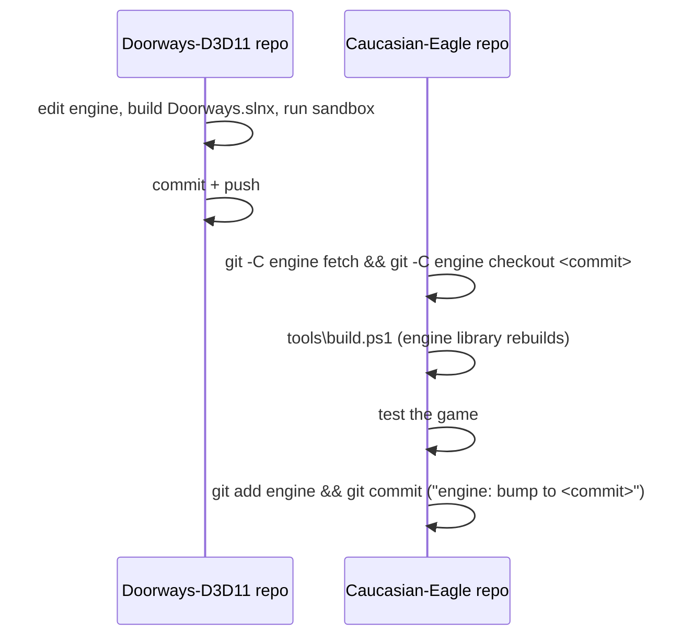

# 6. Core workflows

[← Index](TECHNICAL_DOCUMENTATION.md)

Commands are run from the repository root in PowerShell unless stated otherwise.

## 6.1 Get the project on a new machine

```powershell
git clone --recurse-submodules https://github.com/kalk1t/Caucasian-Eagle.git
cd Caucasian-Eagle
powershell -ExecutionPolicy Bypass -File tools\build.ps1 -Run
```

Needs Visual Studio 2026 with "Desktop development with C++" and the Windows SDK 10.0.26100. `build.ps1` restores the engine's NuGet package, builds, stages and (with `-Run`) starts the game.

## 6.2 Change game code

1. Edit files under `game/src/`.
2. `tools\build.ps1 -Run`.
3. Commit in this repository.

Only the game executable recompiles; the engine library is reused.

## 6.3 Change the engine

The engine is never edited through `engine/` here.



If the game needs something the engine does not offer, add a general option or callback to `engine/src/DOORWAYS/DoorwaysGame.h` in the engine repository. Do not add game names or game-specific branches to engine code ([06-engine-interface.md](06-engine-interface.md)).

## 6.4 Rebuild the hero (Nyxara)

Source files live under `art/nyxara/` on the workstation; the heavy ones are not in git ([art/README.md](../art/README.md)).

```powershell
# 1. Assemble body + wings + swords, author the 31 clips, export the glTF
& "C:\Program Files\Blender Foundation\Blender 5.2\blender.exe" -b -P art\nyxara\blender\assemble.py

# 2. Compile into the engine formats (delete the old bundle first)
Remove-Item -Recurse -Force game\assets\Compiled\Characters\Nyxara\EagleV1
engine\Tools\DoorwaysAssetBuilder\x64\Debug\DoorwaysAssetBuilder.exe character-pipeline `
    art\nyxara\blender\Nyxara_game.glb game\assets\Compiled\Characters\Nyxara\EagleV1 `
    Idle BasicAttack Walk Run StrafeLeft StrafeRight WalkBackward Jump JumpAirborne JumpLanding `
    SlashLeft HeavyAttack Dodge HitReact Death Respawn Skill1 Skill2 Skill3 `
    Combo1L Combo1R Combo2L Combo2R Combo3L Combo3R Guard SwordSwap `
    FlightHover FlightTravel FlightTakeoff FlightLanding

# 3. Stage and run
tools\build.ps1 -Run
```

The pipeline must print `[PASS] Native character pipeline; signature=DoorwaysRig_v1_74bb2d2053cd36e2`. A different signature means the skeleton changed and the clip list or the kit may need updating. The asset builder is an engine tool and is built from the engine repository's solution [confirmed for the engine repository checkout; building it inside the submodule has not been tried].

## 6.5 Rebuild the map (Moonlit Sanctuary)

```powershell
& "C:\Program Files\Blender Foundation\Blender 5.2\blender.exe" -b art\moonlit-sanctuary\Moonlit_Sanctuary_v01.blend `
    -P art\moonlit-sanctuary\Export\export_game_glb.py -- art\moonlit-sanctuary\Export\MoonlitSanctuary_Game_v01.glb

engine\Tools\DoorwaysAssetBuilder\x64\Debug\DoorwaysAssetBuilder.exe scene-pipeline `
    art\moonlit-sanctuary\Export\MoonlitSanctuary_Game_v01.glb game\assets\Compiled MoonlitSanctuary
```

This writes the scene, static mesh, materials and collision files under `game/assets/Compiled/` [inferred from the engine-repository workflow; this exact command has not been run from the game repository yet].

## 6.6 Capture the scripted showcase

```powershell
$env:CAUCASIAN_EAGLE_DEMO = '1'
build\stage\CaucasianEagle\CaucasianEagle.exe
```

The game plays a fixed sequence of skills, combos and movement for about 30 seconds. It is the quickest visual check after a change.

## 6.7 Release a version

See [09-build-package-release.md](09-build-package-release.md).
